# CyberGridML Project Creation

CyberGridML is based on the **SysON** tool. To create a new project, the user selects the **CyberGridML** template, as illustrated in **Figure 1**.

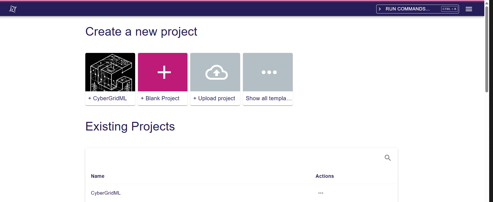
*Figure 1 – Main page project*

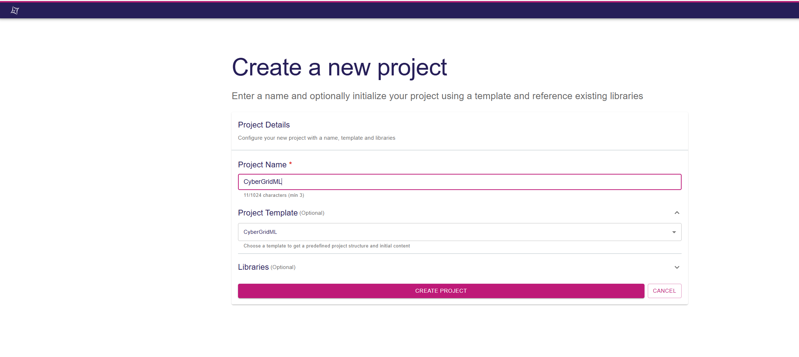
*Figure 2 – Creation of a new project*

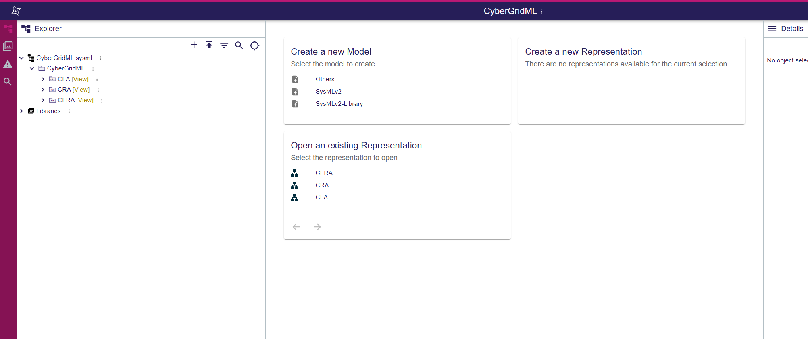
*Figure 3 – project views*

---

# 1. CFA view Creation

A dedicated diagram allows users to create and display the **CFA**.

As a reminder, the user must first create the following mandatory elements:

- **MainGrid**
- **CentralController**
- **ZonalController**
- **Zone**
- **Substation**

Additional control elements can then be created as needed.

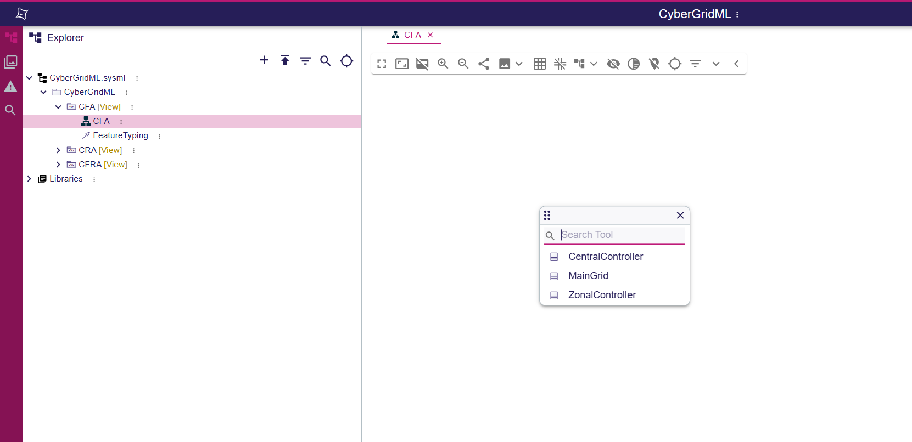
*Figure 4 – CFA elements are added to the view using pop-up context menus*

 Zone and Substation are created from the MainGrid palette.

 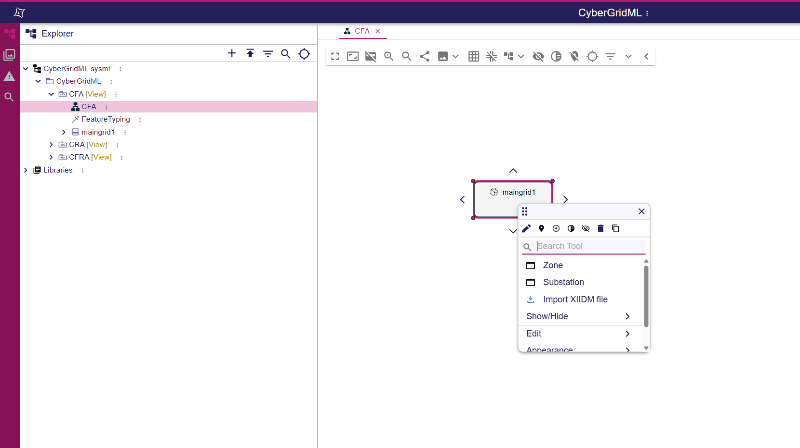
*Figure 5 – Zone and Substation are added to the view using pop-up from MainGrid*

The user must also specify the structure to which each controller is associated. Once all controllers have been defined, the CFA is complete.

Highlighting the creation of a Substation in maingrid.

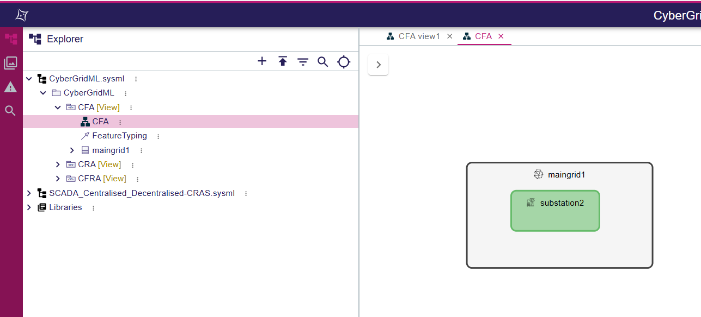

*Figure 6 – Substation in Maingrid*

Highlighting the creation of a zone in maingrid.

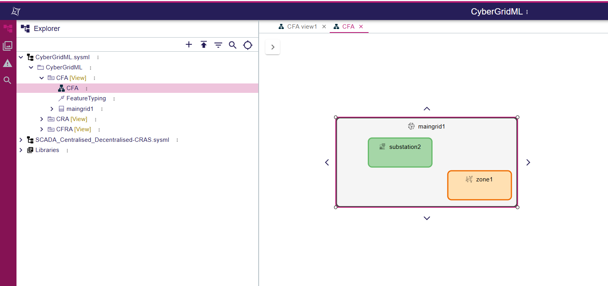

*Figure 7 – Zone in Maingrid*

In the CFA , we can create also CentralController for the MainGrid.

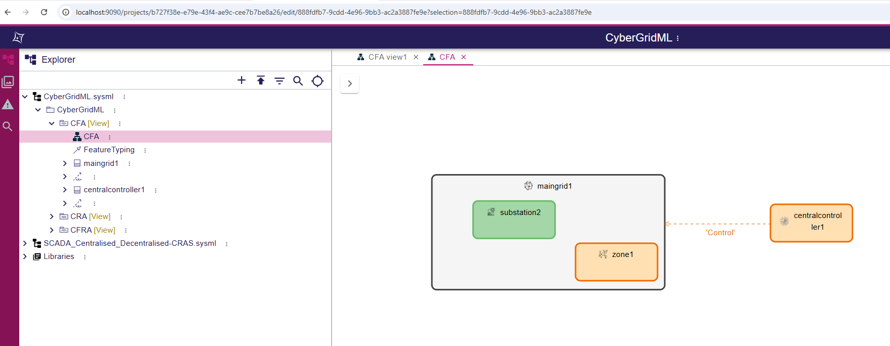

*Figure 8 – CentralController in CFA*

Link a zone to a ZonalController via the Control Link.

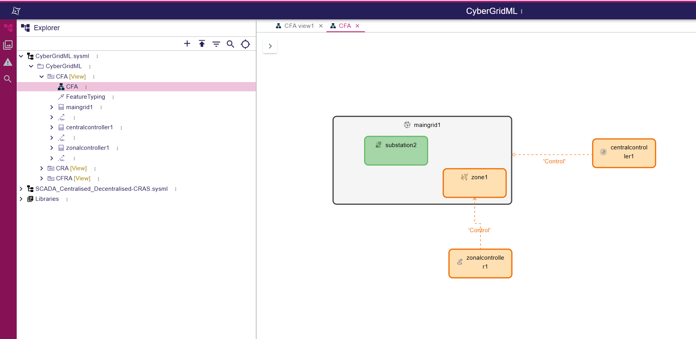

*Figure 9 – Zone-ZonalController Link*

---

# 2. CRA view Creation

A dedicated diagram allows users to create and display the communication and computing resources of the **CRA**.

The following element types can be created:

- **CommunicationMedia** (displayed in blue)
- **ComputingResource** (displayed in green)
- **RedundancyCluster** (displayed in gray)
- **SoftwareResource** (displayed in yellow)

The colors help users quickly identify the different element types within the diagram.

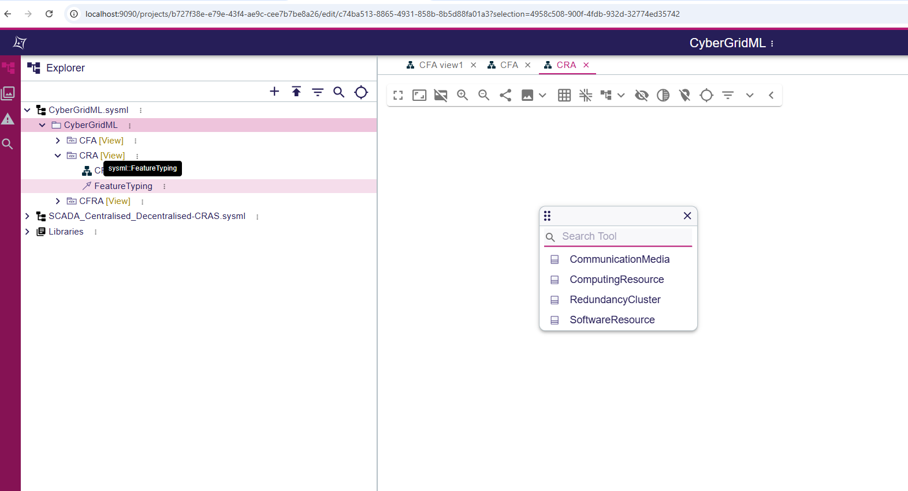

*Figure 10 – Menu showing which elements the user can create in a CRA*

Once these resources have been created, they must be linked together to describe the system architecture:

- Each **SoftwareResource** must be allocated to a **ComputingResource**.
- A **SoftwareResource** may optionally belong to a **RedundancyCluster**.
- Each **ComputingResource** must be connected to at least one **CommunicationMedia**, and may be connected to several.
- **CommunicationMedia** can be connected together to represent the communication network.

A complete CRA for a the SCADA system is illustrated in **Figure 11**.

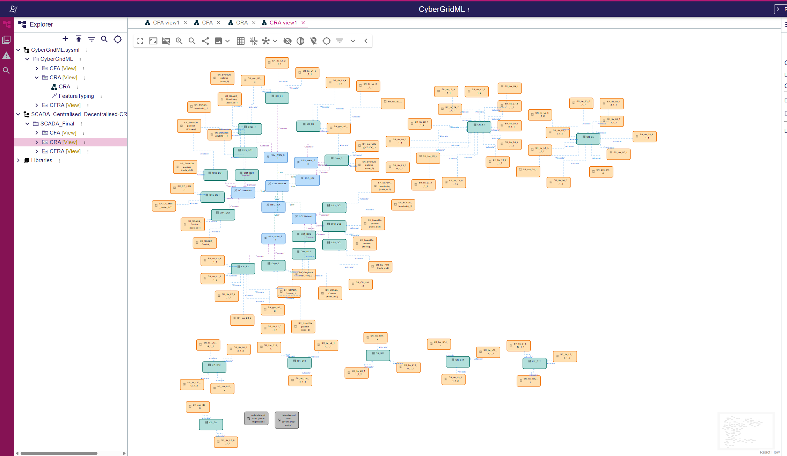

*Figure 11 – CRA example for a modular SCADA system*

Each CRA,CFA or CFRA component has properties whose values can be configured by the user. The **Details** main tab , located on the right-hand side of the window, displays the **CyberGridML** tab that describe each element properties (name, documentation, type, and properties) of the selected element.

Property values can be edited directly from this panel.

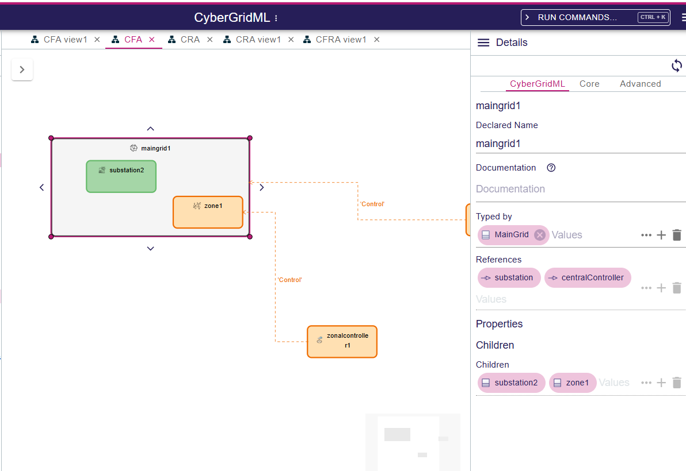

*Figure 12 – CyberGridML tab*

We also provide a feature for linking **communicationmedia** to their corresponding **computingresources**, using the **Connect in Bulk**

*Figure 13 – Connect in Bulk*

we have to choose the **computingresources** in the list.

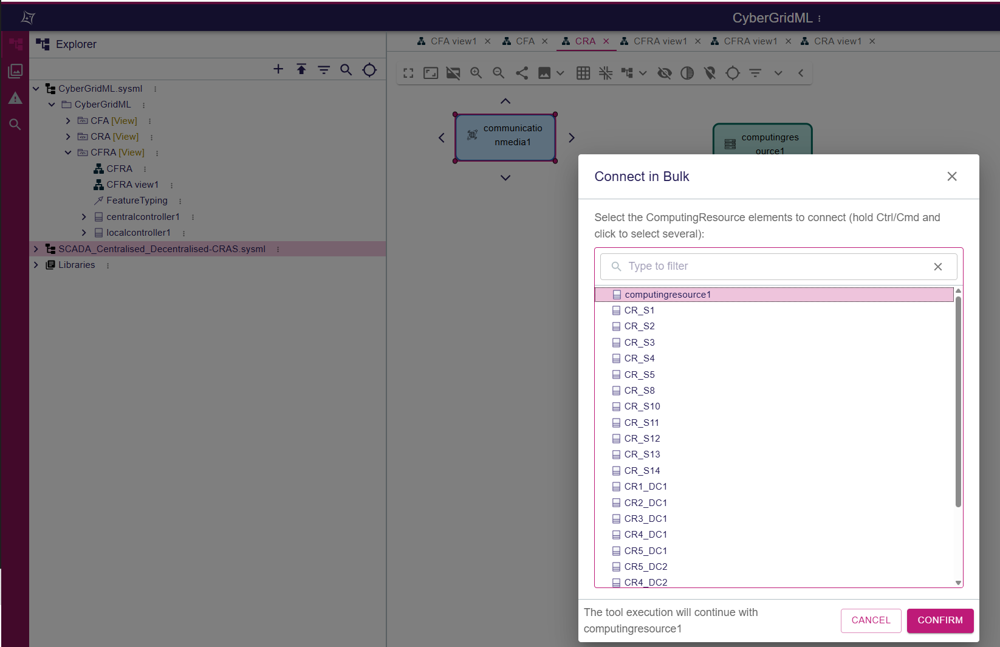

*Figure 14 – Choose the **computingresources***

The link is done 
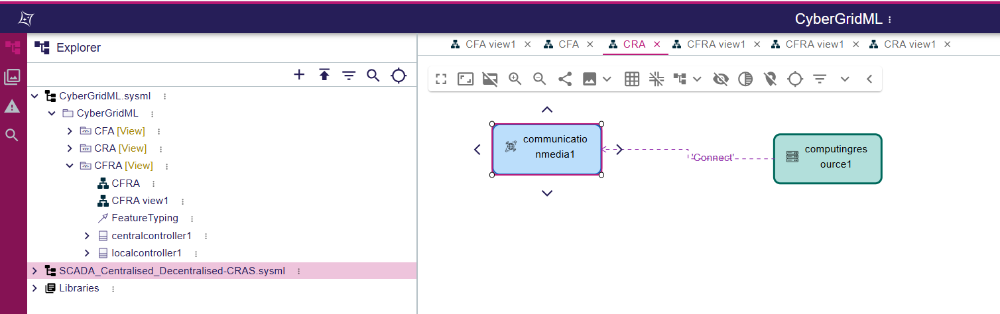

*Figure 15 – **communicationmedia** and **computingresources** link*

# 3. CFRA view Creation

A dedicated diagram allows users to create and display the link between **SoftwareResource** and **Controller** in the **CFRA**.

The following element types can be created:
- **Localcontroller** 
- **Centralcontroller** 

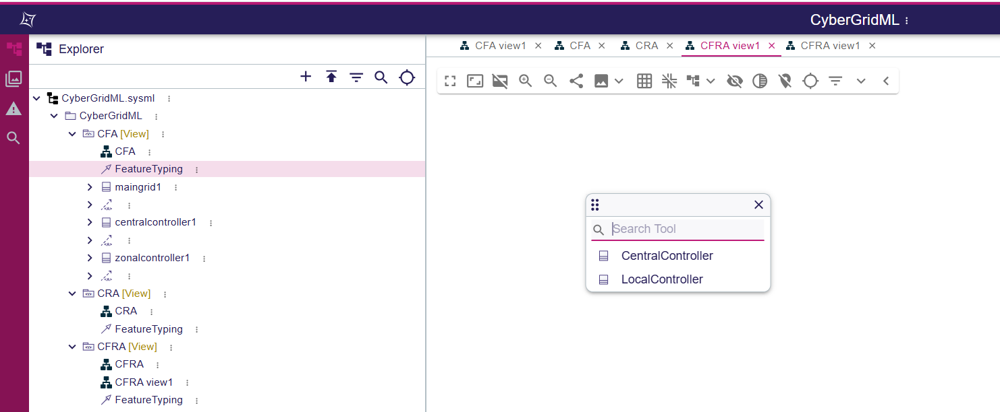

*Figure 16 – Menu showing which elements the user can create in a CFRA*

A complete CFRA for a the SCADA system is illustrated in **Figure 17**.

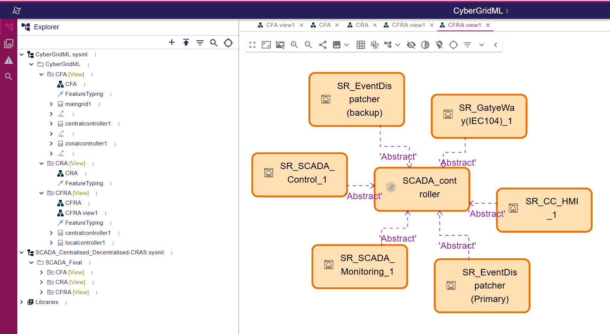

*Figure 17 – CFRA example for a modular SCADA system*

# 4. Hazards Definition

Hazards are properties associated with CRA components. To define a hazard, the user must first select the target element,the user can then apply a hazard to the selected element using the **Toggle Hazard** command. as illustrated in **Figure 18**.

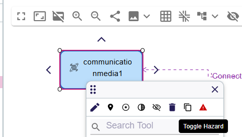

*Figure 18 – Selection of Communicationmedia to toggle with hazard*

To make hazard assignments easily identifiable, elements carrying a hazard are displayed in **red**, as illustrated in **Figure 19**.

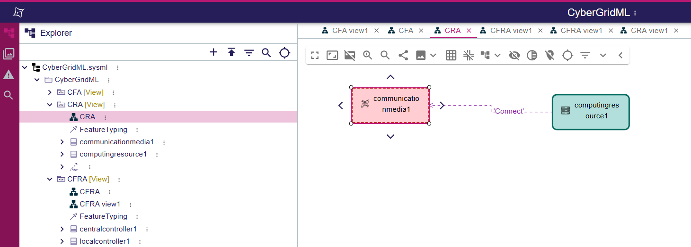

*Figure 19 – Communicationmedia shown in red after hazard application*

Communication hazards include the following properties:

- Description
- Justification
- Percentage of lost messages
- Hazard occurrence period

Once a hazard has been applied to an element, its properties become visible in the **Model Explorer**, as shown in **Figure 20**.

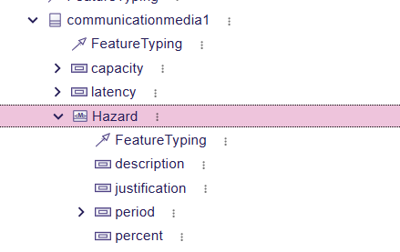

*Figure 20 – Hazard properties are added to Communicationmedia*

# 4. Import XIIDM file

**XIIDM** (eXtended Internal Interconnection Data Model) is a data format used to represent electrical power grid models. It can describe grid components such as buses, lines, generators, loads, transformers, and their electrical parameters.

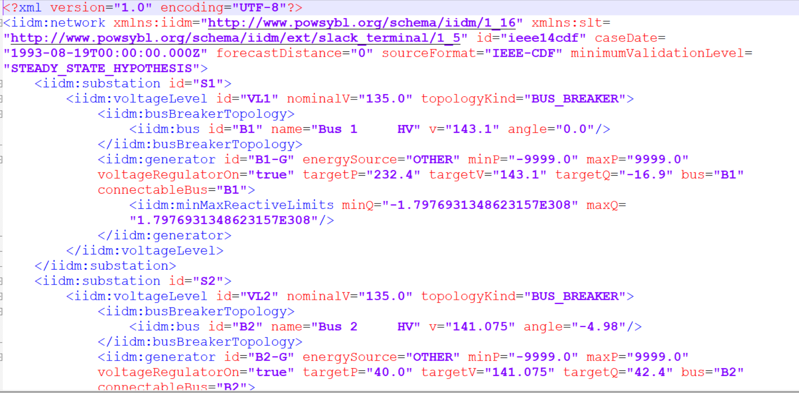

*Figure 21 – Example of XIIDM*

## XIIDM Import Feature

CyberGridML provides a feature that allows users to import models from XIIDM files.
The imported data is used to automatically create the corresponding(CFA, CFRA et CRA).

This feature facilitates the integration of existing power grid models into CyberGridML and reduces the need to manually recreate grid components.

To import an XIIDM file, a MainGrid must first be created in the CFA. This action is available from the MainGrid palette.

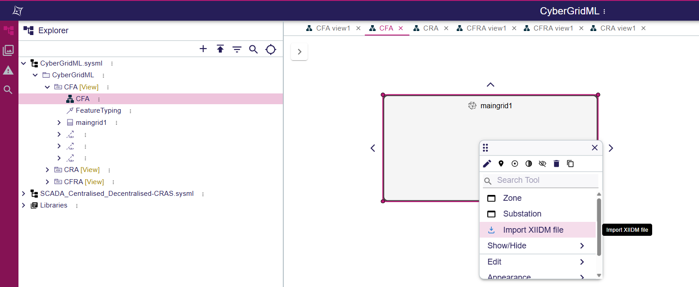

*Figure 22 – Import XIIDM*

We have to select the XIIDM file.

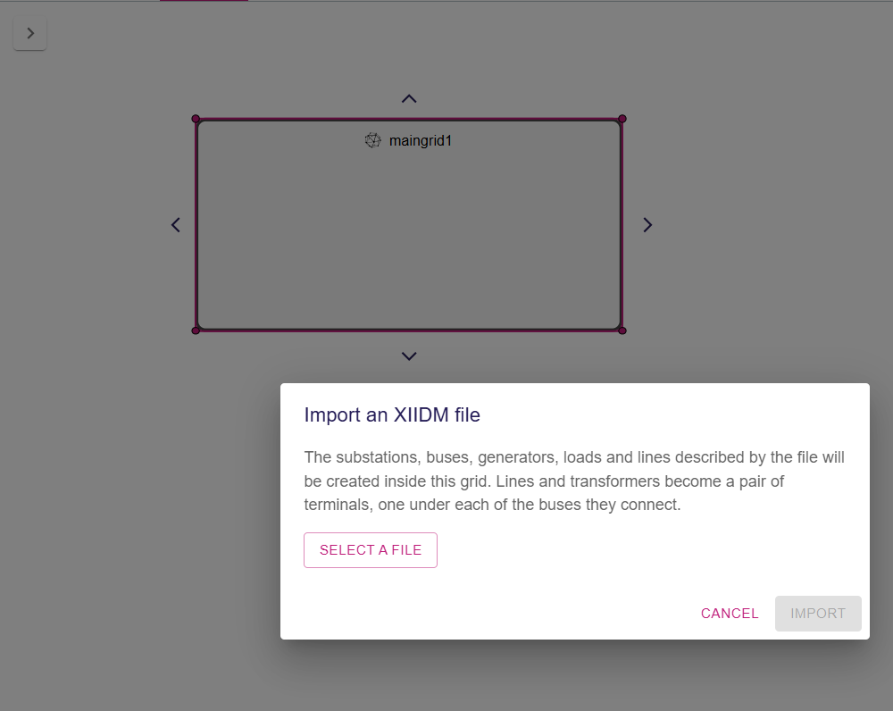

*Figure 23 – Select the XIIDM file*

 Validate the import.
 
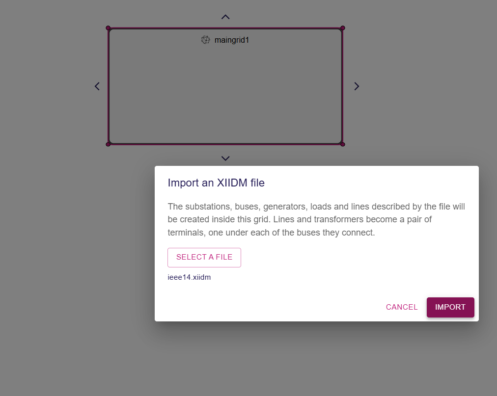

*Figure 24 – Validet the import for the XIIDM*

CFA view after the import. 

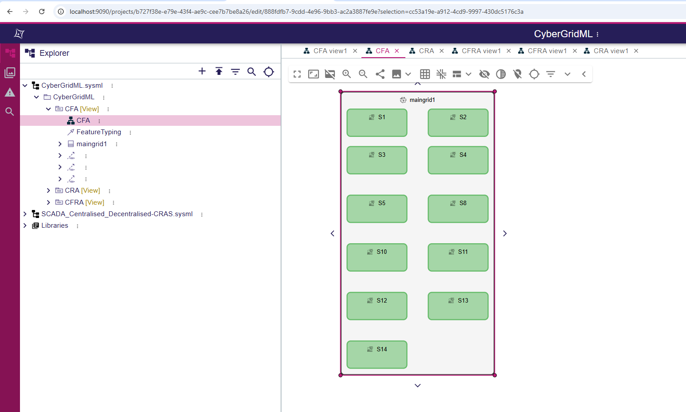

*Figure 25 – CFA view for the XIIDM*

CFRA view after the import.
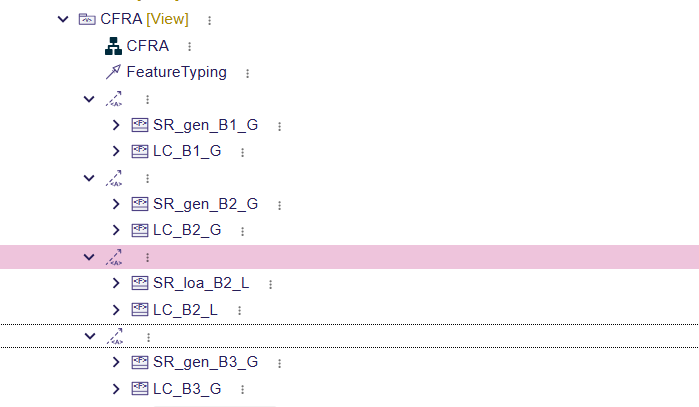

*Figure 26 – CFRA view for the XIIDM*

CRA view after the import. 

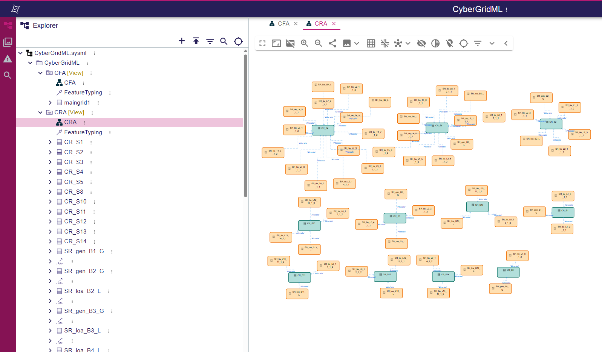

*Figure 25 – CRA view for the XIIDM*

[← Back to the main documentation](README.md)