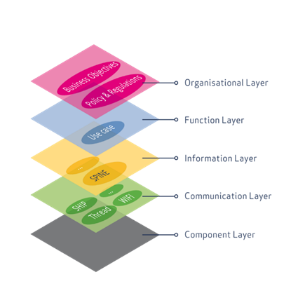

## Concepts

A power grid is an infrastructure that transmits electrical energy from generation sites to consumption sites. At the most basic level of analysis, it can be represented as a directed graph consisting of the following elements :
*	Power lines (graph edges) — These are conductors that carry electrical energy from one point to another. Power lines can be overhead, underground, or submarine. A power line is characterized by its operating voltage, frequency response, leakage currents, and energy loss due to the Joule effect. These characteristics vary depending on the technologies used and climatic conditions (temperature, wind). In addition, each power line has a limit on its mechanical and thermal resistance.
*	Substations (graph nodes) — These are facilities that vary widely in size and technology, whose main functions are:    
  *	Modify voltage between power lines (transformation) 
  *	Dispatch power between several lines (topological connection)
  *	Modify other characteristics of electric current, such as phase, frequency, power factor, etc.
  *	Ensure equipment and personnel protection as a last resort (by isolating a line that has failed or is at risk of failing): circuit breakers, disconnect switches, fuses, surge arresters, etc.
A substation may be connected to any number of production sites and also to any number of consumption sites. When connecting several voltage levels, linked to transformation function, the substation must have several buses, at least one bus per voltage level. A bus may be connected to another bus, as well as to generators, loads or batteries.

The goal of the Cybergrid project is to focus on the control and communication aspects in the electrical grid. The more detailed electrical aspects of the power grid , such as the precise characteristics of each node, the behaviors of each node, etc., are addressed at a high level. Note that it is possible to expand the language in order to describe the electrical grid with more details, but other metamodels already exist to describe in detail all the electrical aspects, such as the [iidm exchange format](https://powsybl.readthedocs.io/projects/powsybl-core/en/stable/grid_model/index.html). Our metamodel can be used in conjunction with such models in order to add the control and communication aspects.

In a similar way, the Cybergrid DSML provides an architectural model at a rather high level of abstraction (functional architecture). It corresponds to the function level in the SGAM architectural framework. It could be enriched to provide more details regarding the lower levels of the SGAM framework, such as the component layer, corresponding to the physical aspects of communication.

