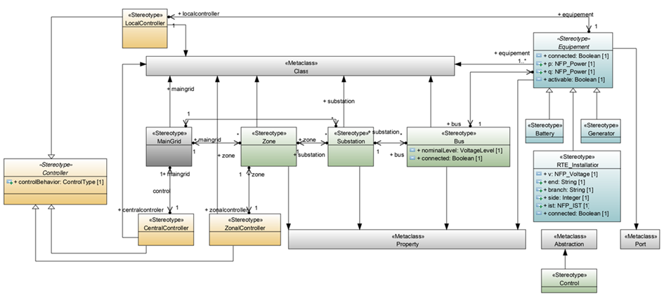
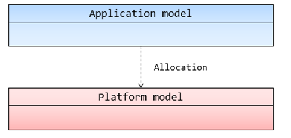

# Modeling Language

The Cybergrid DSML has three modeling levels : 
*	CFA — [Control Function Architecture](#control-functional-architecture) (application level), allowing to model grid elements and control principles.
*	CRA — Control Resource Architecture, allowing to model [telecommunication platforms](#communication-architecture) (networks and communication infrastructure where the controllers are connected), and [execution platforms](#computing-resources) (computing resources executing the control algorithms). 

## Control Functional Architecture

The control functional architecture defines a number of electrical equipments and associated controllers so as to represent the desired control architecture. This is possible through the use of a domain-specific language.

Three control levels can be defined in the CFA :
*	Central control (CC), associated to the  main power grid, represents national-level control, which is responsible for the overall strategy and complex forecasting calculations, and provides the lower levels of controllers with setpoints for optimal operation. The national level has two roles : on one hand, it ensures network balance by estimating future production and consumption over time and, on another hand, it manages electrical flow. At the time being, these roles are mainly carried out manually.
*	Local Control (LC), associated to a substation. The local controllers are responsible for last resort station protection. They also send data to controllers of a higher level and apply orders from these levels if necessary.
*	Zonal Control (ZC), associated to a geographical region or « Zone », with controllers supervising a group of substations and associated local controllers. an intermediate level of control : zonal control. Each zonal controller is responsible for a group of substations within its scope (the « zone »). This automatic, autonomous system should improve control flexibility while guaranteeing as much reliability and security as the current system.

The main concepts of the Cybergrid language are the three types of controllers, displayed in yellow. The power grid base components are in blue, the power grid aggregator components are in green. Sensors and actuators are not represented. Links between entities show that these two blocks have some relationship, for instance a composition relation: a main grid is made from substations, a generalization relation: an equipment may be either a generator, a battery or a terminal (allowing any substation to be controlled), or simply a data sharing relation: a central controller may send recommendations to a zonal controller. These links mean, in service-oriented architectures, that one of the entities provides a service that the other one uses, or requires.

At the functional level, we model the system by decomposing it into logical control functions without any implementation detail, whether software-based or hardware-based. This allows the model to be generic enough to be deployed on various architectures for communication and resources, and thus evaluate the possibilities of deployment.

The functional level of the language allows modeling the control system while taking into account zonal controllers, thus the designer is able to model the zone(s) to be studied and associate them to appropriate control algorithms. This could be leveraged in a simulation tool. 
To account for this type of latency and obtain simulation results that are closer to reality, it is necessary to model the telecommunications platform and its characteristics, which will then be taken into account in the simulation.

## Communication Architecture

A communication platform can be characterized through the set of resources that provides the services necessary for an application to function. In a service-oriented architecture, the application is defined as a client of the platform that uses the services, and the platform is defined as the server that provides the services. Resources may be grouped according to their functionalities: computing resources, storage resources, communication resources, etc. Another way to divide resources is based on whether they are software resources or hardware resources. Software resources can be allocated onto hardware resources.

We use a « CommunicationMedia » concept inspired from the MARTE profile for SysML to model a resource in charge of performing the high-level communication functionality. This allows to model the communication network at a high level of abstraction, the functional level. 
The communication service modeled is in charge of providing communication services to the communicating components in the electrical grid, such as controllers, in order to allow them to exchange messages.  
This concept may be refined to represent more precisely the different OSI layers of a communication network, going all the way to physical layer if needed.

The computing resources are linked to the communication media components, and though this connection the software resources deployed on them can communicate. We present in the next section the execution resources linked to communication network and to controllers.

## Computing Resources

The execution platform groups the resources that are necessary to execute the applications of the power grid, such as the controllers. These can be hardware resources or software resources. For instance, the controllers are realized by software resources deployed on computing resources, such as data centers or virtual machines in a substation.   

This allows to evaluate the impact of various resources architecture by modeling several resources architecture. A designer may choose to deploy a zonal controller either on virtual machines in a decentralized way, or in a data center in a centralized way. Then, simulations can be carried out or analysis tools can be run to evaluate the impacts of the possible choices (Mathilde Arnaud, 2023). 

A Software resource is represented by a concept inspired by MARTE « SwSchedulableResource » . This concept allows to specify whether the software resource is executed periodically and to define the period when it does. Controllers are typically executed periodically, as they are in charge of maintaining systems operations.

To accurately represent the behavior of controllers, we have to model the response times : for example, zonal controllers may send orders to local controllers that may take up to 45 seconds to apply this order. We use a property called « execTime » in order to represent the delay between reception of an order and its execution.

Once computing resources are defined, it is necessary to link software resources to computing resources through an allocation concept.

## Link between the functional and resources architecture

Structural allocations link applications, such as controllers, to the software  components that realize them. Through the allocation of software resources onto hardware resources, this allows to represent where the controllers are executed geographically.

This DSML allows generic modeling  of the communication and execution platform used by applications in order to specify non-functional properties that can be used in various analyses and evaluations of the platforms, thanks to co-simulation for example. 
Note that the language can be easily extended to refine the models if need be and propose models with more details, such as a more detailed communication network.

## Implementation
The metamodel is embedded in a SysOn library.